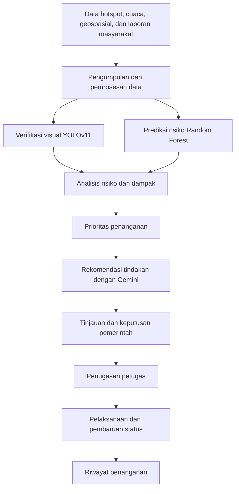
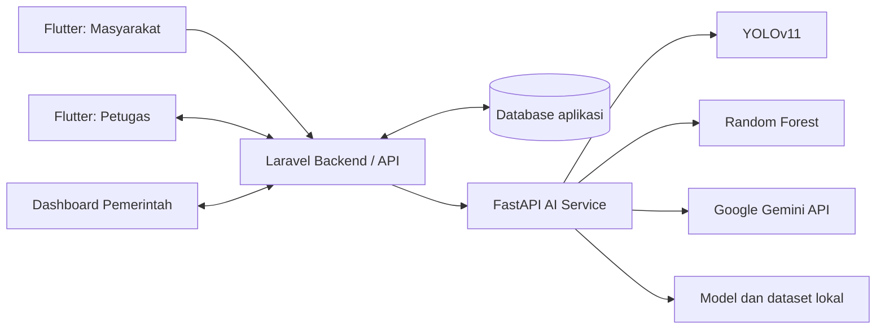

<p align="center">
  
</p>

<h1 align="center">SIGMA</h1>

<p align="center"><strong>Sistem Intelijen Geospasial untuk Mitigasi Karhutla</strong><br>Pantau • Analisis • Prediksi • Aksi</p>
<p align="center"><em>Hutan Aman, Masa Depan Terjaga</em></p>
<p align="center">AI-Powered Geospatial Decision Support for Forest and Land Fire Mitigation</p>

---

## Ringkasan Proyek

**SIGMA** adalah solusi pendukung keputusan mitigasi kebakaran hutan dan lahan (karhutla) yang menggabungkan aplikasi web pemerintah, aplikasi mobile, analisis geospasial (GIS), dan layanan kecerdasan buatan (AI). SIGMA dirancang untuk membantu pihak terkait menghubungkan laporan kejadian dan data lingkungan dengan analisis risiko, penilaian dampak, prioritas penanganan, rekomendasi tindakan, serta koordinasi petugas lapangan.

Proyek ini dikembangkan oleh tim **Ciwi Ciwi Magang** dari **Politeknik Negeri Indramayu** untuk tema **Sustainability** pada **Hackathon JOINTS 2026**.

### Masalah yang ingin dijawab

Informasi karhutla berasal dari beragam sumber dan tidak selalu tersedia dalam satu alur kerja. Hotspot atau laporan kejadian saja belum cukup untuk menentukan lokasi mana yang perlu ditangani lebih dahulu, siapa yang perlu dikerahkan, dan tindakan apa yang patut dipertimbangkan. SIGMA menyatukan informasi yang tersedia dalam alur kerja yang lebih terstruktur agar pengambil keputusan dapat meninjau kondisi wilayah dan menentukan tindak lanjut berdasarkan data.

### Solusi yang ditawarkan

- **Pantau:** meninjau peta, laporan, dan informasi wilayah yang tersedia.
- **Analisis:** memeriksa indikasi visual, prediksi risiko, serta konteks dampak wilayah berdasarkan data yang tersedia.
- **Prediksi dan prioritaskan:** menggunakan keluaran model dan perhitungan prioritas untuk membantu mengurutkan kejadian.
- **Rekomendasikan:** menghasilkan saran tindakan berbantuan AI untuk ditinjau oleh pihak berwenang.
- **Tindak lanjuti:** mendukung penugasan petugas, pembaruan status, laporan perkembangan, dan riwayat penanganan.

> **Catatan akurasi:** README ini membedakan rancangan solusi, catatan pengembangan, dan hal yang harus diverifikasi pada checkout yang sedang digunakan. Ketersediaan data real-time, endpoint, model, bobot, algoritma, dan fitur tertentu bergantung pada konfigurasi serta implementasi repository. SIGMA merupakan sistem pendukung keputusan, bukan pengganti verifikasi manusia atau otoritas penanganan bencana.

## Daftar Isi

- [Tentang SIGMA](#tentang-sigma)
- [Latar Belakang](#latar-belakang)
- [Tujuan](#tujuan)
- [Fitur Utama](#fitur-utama)
- [Pengguna dan Peran](#pengguna-dan-peran)
- [Alur Kerja](#alur-kerja)
- [Arsitektur](#arsitektur)
- [Teknologi](#teknologi)
- [AI dan Machine Learning](#ai-dan-machine-learning)
- [Dataset dan Sumber Data](#dataset-dan-sumber-data)
- [Struktur Repository](#struktur-repository)
- [Persyaratan Sistem](#persyaratan-sistem)
- [Instalasi](#instalasi)
- [Konfigurasi Environment](#konfigurasi-environment)
- [API dan Integrasi](#api-dan-integrasi)
- [Pengujian](#pengujian)
- [Keamanan dan Privasi](#keamanan-dan-privasi)
- [Batasan Sistem](#batasan-sistem)
- [Tim Pengembang](#tim-pengembang)
- [Referensi](#referensi)
- [Lisensi](#lisensi)

## Tentang SIGMA

**SIGMA (Sistem Intelijen Geospasial untuk Mitigasi Karhutla)** adalah platform pendukung pengambilan keputusan yang mengintegrasikan **Artificial Intelligence (AI)** dan **Geographic Information System (GIS)** untuk mendukung pemantauan, pelaporan, analisis risiko, penilaian dampak, penentuan prioritas, rekomendasi tindakan, serta koordinasi penanganan kebakaran hutan dan lahan (karhutla).

SIGMA berupaya menjembatani *decision gap*: kesenjangan antara tersedianya berbagai sumber data karhutla dan kebutuhan informasi yang dapat digunakan untuk menentukan tindakan lapangan. Data hotspot saja belum cukup untuk menjelaskan tingkat risiko, potensi dampak, dan lokasi yang perlu ditangani lebih dahulu. SIGMA mengarahkan data lingkungan, informasi geospasial, laporan masyarakat, serta alur kerja pemerintah dan petugas lapangan ke dalam proses pengambilan keputusan yang lebih terstruktur.

Proyek ini dikembangkan oleh tim **Ciwi Ciwi Magang** dari **Politeknik Negeri Indramayu** untuk tema **Sustainability** pada Hackathon JOINTS 2026.

## Latar Belakang

Penanganan karhutla memerlukan informasi dari berbagai sumber, seperti hotspot satelit, cuaca, tutupan lahan, wilayah gambut, histori kejadian, populasi, fasilitas publik, dan laporan masyarakat. Sumber-sumber tersebut memiliki format, cakupan, dan waktu pembaruan yang berbeda sehingga perlu diolah sebelum dapat digunakan untuk menentukan tindakan.

SIGMA berfokus pada tiga tantangan:

1. **Integrasi informasi:** menghubungkan informasi kejadian, risiko, dan kondisi geospasial dalam satu alur kerja.
2. **Penilaian risiko dan dampak:** memahami lokasi hotspot bersama konteks lingkungan dan potensi paparan masyarakat atau fasilitas.
3. **Prioritas dan koordinasi:** membantu menyusun urutan penanganan ketika beberapa kejadian terjadi bersamaan dan mengelola tugas lapangan.

## Tujuan

- Mendukung pemantauan dan deteksi awal indikasi karhutla.
- Menyediakan visualisasi geospasial untuk memahami kondisi wilayah.
- Mendukung analisis risiko dan potensi dampak berdasarkan data yang tersedia.
- Membantu menyusun prioritas penanganan secara terstruktur.
- Menyediakan rekomendasi tindakan berbantuan AI sebagai bahan pertimbangan.
- Mendukung koordinasi pemerintah, petugas lapangan, dan masyarakat.
- Mendorong pemanfaatan data untuk mitigasi karhutla serta perlindungan ekosistem.

## Fitur Utama

### 1. Government Command Center
Dashboard web pemerintah untuk memantau peta, Analisis Dampak, Prioritas Penanganan, Rekomendasi, penugasan lapangan, dan Riwayat Penanganan.

### 2. Peta Hotspot dan Informasi Geospasial
Peta menyajikan informasi kejadian dan kondisi wilayah yang tersedia. Lapisan dapat mencakup hotspot, cuaca, tutupan lahan, wilayah gambut, populasi, fasilitas publik, histori kejadian, dan laporan masyarakat, bergantung pada sumber serta konfigurasi instalasi.

> Tidak semua lapisan otomatis tersedia atau real-time. Klaim tersebut harus didukung pipeline sumber data dan waktu pembaruan yang dapat diverifikasi.

### 3. Pelaporan Masyarakat
Aplikasi Flutter menyediakan alur pelaporan indikasi kebakaran. Informasi yang tercatat dalam implementasi meliputi foto, koordinat, deskripsi, dan tipe laporan. Field tambahan seperti video, audio, atau waktu kejadian hanya tersedia jika didukung versi aplikasi dan API yang digunakan.

### 4. Verifikasi Visual dengan YOLOv11
Layanan computer vision mendeteksi indikasi visual api dan/atau asap dari gambar. Kelas, bounding box, dan confidence score mengikuti keluaran model yang dikonfigurasi. Hasil deteksi membantu verifikasi awal, tetapi tidak menggantikan pemeriksaan pihak berwenang.

### 5. Prediksi Risiko dengan Random Forest
Model Random Forest memprediksi kelas risiko dari fitur cuaca, karakteristik hotspot, dan koordinat geografis. Hasilnya merupakan dukungan analitis, bukan kepastian bahwa kebakaran akan terjadi.

### 6. Analisis Dampak
Modul Analisis Dampak menyajikan konteks wilayah terdampak, seperti kondisi lingkungan, potensi paparan masyarakat, dan fasilitas relevan berdasarkan data serta metode yang tersedia.

### 7. Prioritas Penanganan
Modul menyusun urutan lokasi atau kejadian untuk membantu pengguna mengidentifikasi item yang lebih mendesak. Proposal menjelaskan pendekatan analisis multi-kriteria dan TOPSIS; algoritma, bobot, dan skor yang aktif harus mengikuti implementasi pada commit yang dijalankan.

### 8. Rekomendasi dengan Google Gemini
Layanan rekomendasi menyusun saran berdasarkan konteks risiko, dampak, dan prioritas yang dikirim ke model. Rekomendasi harus ditinjau petugas atau pejabat berwenang sebelum dijadikan keputusan operasional.

### 9. Manajemen Respons Petugas
Aplikasi petugas mendukung pemuatan dan penerimaan tugas, pembaruan status, pembuatan laporan proses penanganan, serta pencatatan riwayat melalui backend. Status dan transisi mengikuti aturan pada versi aplikasi yang berjalan.

### 10. Riwayat Penanganan
Penugasan dan perkembangan penanganan dapat ditinjau melalui data riwayat backend. Perpindahan dari rekomendasi aktif ke riwayat mengikuti status penugasan dan aturan workflow yang diimplementasikan.

## Pengguna dan Peran

| Peran | Tanggung jawab utama |
|---|---|
| Pemerintah / Administrator | Memantau peta dan laporan, meninjau analisis dampak/prioritas, melihat rekomendasi, menetapkan penugasan, dan memantau riwayat |
| Petugas lapangan | Melihat dan menerima tugas, memperbarui status, serta mengirim laporan perkembangan |
| Masyarakat | Mengirim laporan indikasi karhutla dengan lokasi dan bukti visual yang didukung aplikasi |

## Alur Kerja



Diagram tersebut merupakan alur konseptual. Jalur eksekusi aplikasi dapat berbeda sesuai integrasi fitur dan ketersediaan data pada deployment.

## Alur Penggunaan dari Awal hingga Penanganan

Alur berikut menjelaskan hubungan antarpengguna dan komponen SIGMA. Langkah yang bergantung pada integrasi atau sumber data tertentu perlu diuji pada versi yang dijalankan.

1. **Masyarakat mengirim laporan:** pengguna mengisi informasi laporan, seperti foto, koordinat, deskripsi, dan tipe laporan sesuai field yang tersedia di aplikasi.
2. **Backend menerima laporan:** Laravel memvalidasi permintaan dan menyimpan data melalui mekanisme aplikasi. Keberhasilan penyimpanan foto bergantung pada konfigurasi storage.
3. **Verifikasi visual (jika terintegrasi):** layanan AI memproses gambar menggunakan bobot YOLO yang dikonfigurasi. Hasil deteksi menjadi bahan verifikasi awal, bukan konfirmasi final.
4. **Pemantauan pemerintah:** pengguna pemerintah meninjau laporan dan informasi geospasial yang benar-benar tersedia pada dashboard.
5. **Analisis risiko dan dampak:** sistem menggunakan keluaran model dan data wilayah yang tersedia untuk membantu memahami kondisi serta potensi paparan.
6. **Penentuan prioritas:** modul prioritas menyusun urutan penanganan berdasarkan metode yang benar-benar diterapkan dalam kode.
7. **Pembuatan rekomendasi:** jika layanan Gemini aktif dan terhubung, konteks risiko, dampak, dan prioritas dikirim untuk menghasilkan saran tindakan.
8. **Tinjauan dan penugasan:** pihak berwenang meninjau hasil analisis/rekomendasi dan menetapkan tugas kepada petugas sesuai workflow aplikasi.
9. **Pelaksanaan tugas:** petugas melihat tugas, menerima atau memperbarui status, dan mengirim laporan perkembangan melalui aplikasi yang tersedia.
10. **Riwayat penanganan:** data penugasan dan perubahan status ditinjau melalui fitur riwayat sesuai aturan status backend.

**Penting:** alur ini adalah penjelasan konseptual. Setiap transisi—termasuk pemicu analisis otomatis, notifikasi dini, distribusi per radius, dan pemindahan item rekomendasi ke riwayat—harus dikonfirmasi melalui kode dan pengujian end-to-end. Jangan menyimpulkan suatu transisi otomatis jika implementasinya belum tersedia.

---

## Arsitektur

SIGMA terdiri dari tiga kelompok aplikasi:

1. **Laravel backend dan web dashboard** — mengelola autentikasi, data aplikasi, laporan, workflow pemerintah, penugasan, dan riwayat.
2. **Flutter mobile application** — menyediakan antarmuka bagi masyarakat dan petugas.
3. **FastAPI AI service** — menyediakan endpoint pemrosesan AI, termasuk deteksi visual, prediksi risiko, dan rekomendasi sesuai konfigurasi.



Integrasi aktual antara Laravel dan setiap endpoint AI harus mengikuti konfigurasi serta kode pada repository yang digunakan.

## Teknologi

| Komponen | Teknologi | Fungsi |
|---|---|---|
| Backend dan dashboard web | Laravel, PHP, Blade, Vite | API, autentikasi, dashboard, workflow |
| Aplikasi mobile | Flutter, Dart | Pelaporan dan antarmuka petugas |
| AI service | Python, FastAPI, Uvicorn | Endpoint pemrosesan AI |
| Deteksi visual | YOLOv11 | Deteksi objek api/asap sesuai bobot model |
| Prediksi risiko | Random Forest, scikit-learn | Prediksi kelas risiko dari fitur tabular |
| Rekomendasi | Google Gemini API | Generasi rekomendasi tindakan |
| Pemrosesan data | NumPy, pandas, joblib, dan dependency terkait | Pengolahan data dan pemuatan model |
| Penyimpanan | Database sesuai konfigurasi Laravel | Data aplikasi dan workflow |
| Pemetaan | Pustaka peta dan layer yang dikonfigurasi | Visualisasi informasi geospasial |

Versi dependency, database aktif, pustaka peta, serta algoritma analisis harus dikonfirmasi melalui konfigurasi dan kode sumber pada checkout yang dijalankan.

## AI dan Machine Learning

### YOLOv11 — Computer Vision

**Tujuan:** mendeteksi indikasi visual api dan asap pada foto laporan masyarakat.

Riwayat pengembangan mencatat pengujian endpoint `POST /detect/fire-smoke` menggunakan bobot `firedetect-11s.pt`. Nama `yolo11n.pt` juga pernah digunakan dalam pengujian lain dan tidak boleh dianggap sebagai bobot yang sama.

Contoh keluaran inferensi yang pernah dicatat:

- Fire confidence sekitar `0.731`.
- Fire confidence sekitar `0.7124`.
- Smoke confidence sekitar `0.3007`.
- Flag deteksi api/asap dilaporkan aktif pada salah satu contoh respons.

Nilai tersebut merupakan contoh hasil inferensi pada gambar tertentu, **bukan** metrik akurasi, precision, recall, atau mAP keseluruhan. Kelas aktual mengikuti metadata bobot. Label `No Fire` atau `Uncertain` tidak boleh dianggap kelas bawaan model kecuali didukung oleh model atau logika aplikasi.

### Random Forest — Prediksi Risiko

Artefak model yang tercatat:

```text
ai_service/ai_service_sigma/models/fire_risk_model.pkl
```

Model pernah dimuat sebagai dictionary dengan key `model`, `encoder`, dan `features`. Objek model dilaporkan sebagai `RandomForestClassifier`, sementara encoder berupa `LabelEncoder`.

Sepuluh fitur yang pernah ditemukan:

| Fitur | Makna umum |
|---|---|
| `T2M` | Temperatur udara pada ketinggian 2 meter |
| `RH2M` | Kelembapan relatif pada ketinggian 2 meter |
| `PRECTOTCORR` | Curah hujan terkoreksi |
| `WS10M` | Kecepatan angin pada ketinggian 10 meter |
| `ALLSKY_SFC_SW_DWN` | Radiasi gelombang pendek permukaan pada kondisi all-sky |
| `brightness` | Karakteristik brightness hotspot |
| `confidence` | Confidence data hotspot sesuai sumbernya |
| `frp` | Fire Radiative Power |
| `latitude` | Koordinat lintang |
| `longitude` | Koordinat bujur |

Satuan, sumber, rentang waktu, preprocessing, dan urutan fitur harus konsisten dengan pipeline training dan inference.

Pemeriksaan yang pernah dilaporkan menemukan kelas encoder `LOW` dan `MEDIUM`. Satu contoh inferensi menghasilkan `MEDIUM` dengan keluaran `[0.15, 0.85]`. Ini bukan bukti akurasi model dan tidak membuktikan bahwa artefak yang sama menghasilkan kelas `HIGH`. Jika UI menampilkan kelas lain, telusuri apakah kelas tersebut berasal dari aturan bisnis, skor risiko terpisah, atau model berbeda.

### Google Gemini — AI Recommendation

Gemini menghasilkan rekomendasi teks berdasarkan konteks yang dikirimkan ke router rekomendasi FastAPI. Konteks dapat mencakup risiko, dampak, prioritas, dan informasi wilayah yang tersedia. Gemini bukan model deteksi gambar dan bukan model Random Forest; kualitas respons bergantung pada input, prompt, dan layanan API.

Variabel environment yang pernah digunakan:

```env
GEMINI_API_KEY=your_api_key_here
GEMINI_MODEL=your_configured_model
```

Gunakan nama model yang valid dan dikonfigurasi proyek. Jangan commit API key atau file `.env` ke repository.

### Analisis Geospasial dan Prioritas

SIGMA menggabungkan informasi lokasi dengan indikator lingkungan dan sosial untuk mendukung analisis dampak serta prioritas. Proposal menjelaskan pendekatan weighted overlay/MCDA dan TOPSIS. Pastikan metode, bobot, normalisasi, kriteria, dan rumus yang diklaim sesuai dengan kode yang benar-benar berjalan.

## Dataset dan Sumber Data

### A. Dataset gambar untuk deteksi api dan asap

Proposal SIGMA mencatat dua kelompok dataset computer vision. Angka berikut adalah catatan dalam dokumen perancangan; verifikasi manifest, versi, lisensi, dan isi dataset yang benar-benar digunakan untuk melatih bobot deployment.

**Dataset 1 — Fire & Smoke**

| Pembagian | Jumlah gambar |
|---|---:|
| Training | 14.122 |
| Validation | 3.099 |
| Testing | 4.306 |
| **Total** | **21.527** |

Jumlah anotasi yang dicatat: **26.557**, terdiri dari 14.692 anotasi Fire dan 11.865 anotasi Smoke.

**Dataset 2 — Fire Only**

| Pembagian | Jumlah gambar |
|---|---:|
| Training | 26.379 |
| Validation | 4.394 |
| Testing | 1.830 |
| **Total** | **32.603** |

Kedua set berbeda. Jangan menjumlahkannya sebagai jumlah gambar unik tanpa memastikan tidak ada tumpang tindih. Sumber unduhan, lisensi, format anotasi, tanggal pengambilan, dan hubungan dataset dengan bobot `firedetect-11s.pt` perlu diisi berdasarkan metadata atau sumber dataset sebenarnya. README ini tidak mengasumsikan kedua dataset pasti digunakan untuk melatih bobot yang sedang dipakai.

### B. Dataset prediksi risiko

Path dataset hasil pemrosesan yang tercatat:

```text
ai_service/ai_service_sigma/dataset/processed/fire_risk_dataset.csv
```

Ukuran file yang pernah dilaporkan sekitar **21.389.652 byte**. Dataset ini berkaitan dengan model Random Forest dan fitur cuaca, hotspot, serta koordinat.

Informasi yang perlu dicatat dari dataset dan script preprocessing:

- Sumber asli dan lisensi data.
- Jumlah baris, kolom, serta periode data.
- Cakupan geografis dan resolusi temporal.
- Definisi target atau label risiko.
- Penanganan nilai kosong, duplikasi, dan outlier.
- Pembagian train/validation/test serta pencegahan data leakage.
- Versi preprocessing dan metrik evaluasi.

Jangan mengarang jumlah baris, rentang tanggal, atau akurasi yang belum diukur.

### C. Sumber data lingkungan dan geospasial

| Kategori | Contoh penggunaan | Informasi yang perlu dicatat |
|---|---|---|
| Hotspot satelit | Indikasi anomali panas | NASA FIRMS atau sumber aktual, produk satelit, waktu observasi, lisensi |
| Cuaca | Temperatur, kelembapan, curah hujan, angin, radiasi | Provider, parameter, satuan, periode, waktu pembaruan |
| Tutupan lahan | Konteks vegetasi dan penggunaan lahan | Sumber layer, tahun, resolusi, lisensi |
| Wilayah gambut | Identifikasi area gambut | Sumber layer, cakupan, resolusi |
| Populasi | Konteks potensi paparan masyarakat | Sumber, tahun, resolusi, batas penggunaan |
| Fasilitas publik | Konteks potensi dampak | Sumber dan waktu pembaruan |
| Histori kejadian | Analisis historis | Tabel/file sumber, periode, metode validasi |
| Laporan masyarakat | Informasi kejadian dan bukti visual | Data aplikasi, izin penggunaan, kebijakan privasi |

NASA FIRMS dan NASA POWER disebut dalam rancangan sumber data. Koneksi langsung ke layanan tersebut harus diverifikasi dari pipeline ingest atau konfigurasi deployment. Penyebutan sumber pada proposal tidak otomatis berarti sumber telah terhubung secara real-time.

### D. Dataset peta dan data dummy

Sebelum mengklaim bahwa peta menggunakan data operasional:

1. Telusuri controller, service, query, atau endpoint pemasok marker.
2. Identifikasi tabel/file dan sumber aslinya.
3. Bedakan data seeder/dummy dari data aktual.
4. Verifikasi koordinat, timestamp, atribut, dan satuan.
5. Tampilkan atribusi sumber serta waktu pembaruan bila tersedia.
6. Dokumentasikan proses impor atau sinkronisasi.

Data simulasi harus diberi label jelas dan tidak dicampur tanpa penanda dengan data aktual.

## Struktur Repository

Struktur utama yang tercatat pada repository:

```text
SIGMA/
├── ai_service/
│   └── ai_service_sigma/
│       ├── main.py
│       ├── config.py
│       ├── routers/
│       │   ├── fire_risk.py
│       │   └── recommendation.py
│       ├── models/
│       │   └── fire_risk_model.pkl
│       ├── dataset/
│       │   └── processed/
│       │       └── fire_risk_dataset.csv
│       └── requirements.txt
├── backend/
│   └── web_sigma/          # Laravel backend dan dashboard web
├── frontend/
│   └── apk_sigma/          # Flutter mobile, jika sesuai checkout
├── docs/
│   └── assets/
│       └── logo-sigma.jpeg
└── README.md
```

**Catatan:** cocokkan struktur ini dengan branch dan commit terbaru. Lokasi aplikasi Flutter, entry point FastAPI, dan file aset dapat berbeda pada checkout aktual.

## Persyaratan Sistem

- Git.
- PHP dan Composer sesuai `composer.json`.
- Database yang didukung dan dikonfigurasi backend.
- Node.js dan npm untuk aset Vite jika digunakan.
- Python dan pip untuk AI service.
- Flutter SDK untuk aplikasi mobile.
- API key Google Gemini jika endpoint rekomendasi digunakan.
- File model dan dataset yang dibutuhkan layanan AI.

Versi pasti mengikuti `composer.json`, `package.json`, `pubspec.yaml`, `requirements.txt`, dan konfigurasi AI. Riwayat pengembangan pernah menggunakan PHP 8.3.16 dan Laravel 13.32.0; gunakan versi yang ditetapkan checkout yang dijalankan.

## Panduan Cepat Menjalankan SIGMA

Panduan ini merupakan ringkasan urutan kerja. Ikuti bagian **Instalasi**, **Konfigurasi Environment**, dan **API dan Integrasi** di bawah untuk detail serta penyesuaian terhadap source code pada branch yang digunakan.

1. **Siapkan kebutuhan:** Git, PHP dan Composer, database yang digunakan backend, Node.js/npm jika aset Vite diperlukan, Python/pip, Flutter SDK, serta kredensial Gemini jika fitur rekomendasi digunakan.
2. **Siapkan backend:** masuk ke `backend/web_sigma`, instal dependency Composer, salin `.env.example` menjadi `.env`, atur database, buat application key, jalankan migrasi, lalu mulai server Laravel.
3. **Siapkan AI service:** masuk ke `ai_service/ai_service_sigma`, buat dan aktifkan virtual environment, instal `requirements.txt`, periksa lokasi model/dataset serta konfigurasi Gemini, kemudian jalankan FastAPI.
4. **Siapkan aplikasi mobile:** masuk ke direktori Flutter yang benar pada checkout, jalankan `flutter pub get`, lalu jalankan aplikasi dengan `API_BASE_URL` yang mengarah ke backend.
5. **Verifikasi integrasi:** pastikan backend dapat mengakses database, aplikasi dapat mengakses API, dan backend benar-benar dikonfigurasi untuk memanggil endpoint AI yang dibutuhkan.
6. **Uji alur utama:** uji login/role, laporan masyarakat, pemrosesan gambar bila tersedia, tampilan data pemerintah, analisis dan prioritas, rekomendasi, penugasan petugas, pembaruan status, dan riwayat.

Jalankan backend, AI service, dan Flutter pada terminal terpisah. Jangan menganggap seluruh fitur telah terintegrasi hanya karena masing-masing server berhasil dijalankan.

---

## Instalasi

Langkah berikut adalah panduan pengembangan lokal. Jalankan setiap komponen di terminal terpisah. Cocokkan nama folder, entry point, dan variabel environment dengan repository yang di-clone.

### 1. Clone repository

```bash
git clone https://github.com/audyzahra/SIGMA.git
cd SIGMA
git status
```

### 2. Backend Laravel

```bash
cd backend/web_sigma
composer install
```

Buat file environment lokal. Windows Command Prompt:

```bat
copy .env.example .env
```

PowerShell atau Git Bash:

```bash
cp .env.example .env
```

Atur koneksi database dan konfigurasi lain di `.env`. Pastikan database sudah dibuat, kemudian jalankan:

```bash
php artisan key:generate
php artisan migrate
```

Jika proyek menggunakan seeder, periksa isi seeder dan pastikan database aman untuk diisi sebelum menjalankan:

```bash
php artisan db:seed
```

> `php artisan migrate:fresh --seed` menghapus tabel dan data yang ada. Jangan jalankan pada database yang berisi data penting.

Bangun aset web jika Vite digunakan:

```bash
npm install
npm run build
```

Jalankan backend:

```bash
php artisan serve --host=0.0.0.0 --port=8080
```

Backend lokal biasanya tersedia di `http://127.0.0.1:8080`. Jika aplikasi menggunakan public storage link untuk foto dan link belum ada, jalankan:

```bash
php artisan storage:link
```

### 3. AI service FastAPI

Buka terminal baru dari root repository:

```bash
cd ai_service/ai_service_sigma
python -m venv venv
```

Aktifkan pada Windows Command Prompt:

```bat
venv\Scripts\activate
```

Aktifkan pada PowerShell:

```powershell
.\venv\Scripts\Activate.ps1
```

Pasang dependency:

```bash
python -m pip install --upgrade pip
pip install -r requirements.txt
```

Konfigurasikan environment AI service, path model/dataset, serta Gemini jika diperlukan. Jangan memasukkan API key ke Git.

Jika file aplikasi bernama `main.py` dan objek FastAPI bernama `app`, jalankan:

```bash
uvicorn main:app --reload --host 0.0.0.0 --port 8000
```

Jika nama modul atau objek berbeda, sesuaikan perintah dengan source aktual. Dokumentasi API biasanya tersedia di `http://127.0.0.1:8000/docs` jika dokumentasi otomatis diaktifkan.

Pastikan model dan dataset tersedia pada path yang diharapkan:

```text
models/fire_risk_model.pkl
dataset/processed/fire_risk_dataset.csv
```

Bobot YOLO yang digunakan endpoint juga harus tersedia pada path yang ditetapkan konfigurasi. Nama `firedetect-11s.pt` dalam riwayat pengujian tidak menjamin file tersebut ada pada checkout saat ini.

### 4. Aplikasi Flutter

Buka terminal baru dari root repository. Contoh ini mengasumsikan aplikasi berada di `frontend/apk_sigma`:

```bash
cd frontend/apk_sigma
flutter pub get
flutter devices
```

Contoh menjalankan Flutter Web jika proyek mendukung Chrome:

```bash
flutter run -d chrome --dart-define=API_BASE_URL=http://127.0.0.1:8080/api
```

Pastikan nama compile-time variable sesuai implementasi konfigurasi API pada source code.

**Perangkat fisik:** ganti `127.0.0.1` dengan alamat IP komputer yang dapat dijangkau perangkat. Alamat loopback pada ponsel menunjuk ke ponsel itu sendiri, bukan komputer pengembang. Pastikan firewall, CORS, dan jaringan mengizinkan koneksi.

### 5. Urutan menjalankan sistem

1. Pastikan database aktif.
2. Jalankan Laravel backend.
3. Jalankan AI service jika fitur yang diuji memerlukannya.
4. Jalankan Flutter Web atau aplikasi pada perangkat.
5. Pastikan URL API dan URL AI service sesuai environment lokal.
6. Uji login dan endpoint dasar.
7. Uji pelaporan, deteksi gambar, analisis, rekomendasi, dan penugasan sesuai fitur yang aktif.

Menjalankan FastAPI saja tidak otomatis membuat Laravel memanggil seluruh endpoint AI. URL, timeout, request, dan penanganan respons harus terhubung pada kode backend.

## Konfigurasi Environment

Nama variabel berikut adalah contoh dan harus dicocokkan dengan file konfigurasi aktual.

### Laravel

```env
APP_NAME=SIGMA
APP_ENV=local
APP_DEBUG=true
APP_URL=http://127.0.0.1:8080

DB_CONNECTION=mysql
DB_HOST=127.0.0.1
DB_PORT=3306
DB_DATABASE=your_database
DB_USERNAME=your_username
DB_PASSWORD=your_password
```

Contoh ini menggunakan MySQL/MariaDB. Gunakan driver yang benar-benar dipakai proyek. Jangan gunakan kredensial contoh pada produksi.

### AI service

```env
GEMINI_API_KEY=your_api_key_here
GEMINI_MODEL=your_configured_model
```

Tambahkan konfigurasi URL atau path model hanya jika variabel tersebut memang dibaca oleh kode. Jangan menebak nama environment variable yang tidak digunakan aplikasi.

### Flutter

Contoh compile-time API base URL:

```bash
--dart-define=API_BASE_URL=http://127.0.0.1:8080/api
```

Periksa nama variable di source. Untuk perangkat fisik, gunakan alamat host yang dapat dijangkau perangkat.

## API dan Integrasi

Endpoint di bawah pernah disebut dalam riwayat pengembangan. Daftar ini **harus diverifikasi** terhadap `routes/api.php` dan router FastAPI pada commit terbaru; bukan kontrak API lengkap.

### Endpoint petugas yang tercatat

| Method | Path | Kegunaan |
|---|---|---|
| GET | `/api/officer/dashboard` | Data dashboard petugas |
| GET | `/api/officer/map` | Data peta petugas |
| GET | `/api/officer/notifications` | Notifikasi jika tersedia |
| GET | `/api/officer/profile` | Profil petugas |
| GET | `/api/officer/reports` | Daftar laporan petugas |
| GET | `/api/officer/tasks` | Daftar tugas |
| GET | `/api/officer/tasks/{task}` | Detail tugas |
| PATCH | `/api/officer/tasks/{task}/accept` | Menerima tugas |
| POST | `/api/officer/tasks/{task}/reports` | Mengirim laporan proses penanganan |
| PATCH | `/api/officer/tasks/{task}` | Memperbarui tugas/status sesuai validasi backend |

### Endpoint masyarakat yang tercatat

| Method | Path / pola | Kegunaan |
|---|---|---|
| POST | `/api/citizen/reports` | Membuat laporan masyarakat |
| GET | Endpoint daftar laporan pada router citizen | Mengambil daftar laporan |
| GET | Endpoint detail laporan pada router citizen | Mengambil detail laporan |

Path daftar dan detail perlu diambil langsung dari route backend sebelum dijadikan dokumentasi API final.

### Endpoint AI yang tercatat

| Method | Path | Kegunaan |
|---|---|---|
| POST | `/detect/fire-smoke` | Inferensi deteksi api/asap pada gambar |

Prefix router, field multipart, format response, autentikasi, dan endpoint prediksi/rekomendasi perlu diperiksa pada OpenAPI `/docs` atau source router.

## Pengujian

Riwayat pengembangan mencatat pemeriksaan dependency Python, pemuatan artefak Random Forest, pengujian endpoint YOLO, pengembangan API laporan masyarakat, integrasi API petugas, serta debugging workflow rekomendasi dan riwayat.

Checklist untuk commit yang akan diserahkan:

- [ ] Backend berjalan dan terhubung ke database.
- [ ] Login dan akses berbasis role berjalan.
- [ ] Dashboard pemerintah dapat memuat data.
- [ ] Endpoint daftar/detail laporan dapat diuji.
- [ ] Foto laporan tersimpan dan dapat diakses sesuai kebijakan storage.
- [ ] Endpoint AI menangani input valid dan tidak valid.
- [ ] Random Forest menerima fitur dengan urutan dan tipe yang benar.
- [ ] Gemini menangani timeout dan error API.
- [ ] Petugas dapat memuat, menerima, dan memperbarui tugas sesuai aturan status.
- [ ] Penugasan tidak tetap muncul sebagai rekomendasi aktif jika workflow mengharuskannya masuk riwayat.
- [ ] Sumber marker peta ditelusuri dan data dummy diberi label.
- [ ] Alur end-to-end diuji dan hasilnya dicatat.

Contoh inferensi bukan pengganti evaluasi model. Laporkan metrik performa hanya setelah menghitungnya pada validation/test set yang sesuai.

## Pemecahan Masalah Umum

| Gejala | Hal yang perlu diperiksa |
|---|---|
| Composer gagal memasang dependency | Versi PHP dan ekstensi yang diwajibkan `composer.json`, termasuk ekstensi ZIP jika diminta dependency. |
| Laravel tidak dapat terhubung ke database | Nilai `DB_*` di `.env`, status database, nama database, kredensial, dan driver yang digunakan. |
| Flutter gagal mengambil API atau muncul error CORS | URL API, alamat IP host, port, konfigurasi CORS Laravel, firewall, dan apakah backend sedang berjalan. Pada perangkat fisik, `127.0.0.1` menunjuk ke perangkat itu sendiri. |
| API mengembalikan `422 Unprocessable Content` | Periksa field wajib dan format payload yang dikirim oleh aplikasi dibandingkan dengan validasi backend. |
| FastAPI tidak dapat dimulai | Aktifkan virtual environment, instal dependency, pastikan modul/objek ASGI sesuai, dan periksa traceback terminal. |
| Model AI tidak ditemukan | Periksa path relatif/absolut yang digunakan konfigurasi dan pastikan file model tersedia pada lokasi tersebut. |
| Rekomendasi AI gagal | Periksa nama model Gemini, API key melalui environment, konektivitas, kuota, timeout, dan log error tanpa mencetak secret. |
| Peta menampilkan data yang tidak sesuai | Telusuri controller/service/endpoint sumber marker, koordinat, timestamp, dan apakah data berasal dari seeder atau sumber operasional. |

Gunakan pesan error dan log aktual untuk menentukan penyebab. Tabel ini merupakan panduan pemeriksaan awal, bukan klaim bahwa seluruh masalah tersebut sedang terjadi pada setiap instalasi.

---

## Keamanan dan Privasi

- Jangan commit `.env`, API key Gemini, password database, token, atau secret lainnya.
- Pastikan `.gitignore` mengecualikan environment lokal, cache, hasil build, dan file rahasia.
- Terapkan autentikasi dan otorisasi role pada endpoint yang sesuai.
- Validasi tipe, ukuran, dan isi file yang diunggah.
- Lindungi foto, lokasi, identitas, dan informasi pribadi pelapor.
- Hindari mencatat token atau data sensitif pada log.
- Gunakan dataset dan bobot model sesuai lisensi sumbernya.
- Jangan mengirim data pribadi yang tidak diperlukan ke API eksternal.
- Rotasi API key jika pernah terpublikasi.

## Batasan Sistem

- Data hotspot menunjukkan indikasi anomali panas; tidak setiap hotspot merupakan kebakaran yang telah terverifikasi.
- Deteksi visual dipengaruhi kualitas gambar, bobot model, kelas, dan threshold.
- Prediksi risiko dipengaruhi kualitas data, distribusi training, preprocessing, dan konsistensi fitur.
- Gemini dapat menghasilkan saran yang tidak lengkap atau keliru.
- Data cuaca dan geospasial dapat memiliki resolusi serta waktu pembaruan berbeda.
- Data dummy, simulasi, dan operasional harus dibedakan.
- Fitur offline-first, sinkronisasi, notifikasi dini, atau distribusi per radius hanya boleh dianggap tersedia jika implementasi dan pengujiannya telah dikonfirmasi.
- SIGMA adalah sistem pendukung keputusan, bukan pengganti otoritas penanganan bencana.

## Tim Pengembang

**Ciwi Ciwi Magang — Politeknik Negeri Indramayu**

| Nama | Peran |
|---|---|
| Audy Zahra Aditya Putri | Ketua Tim |
| Virna Nanju Fernanda | Anggota |
| Evi Meliyani | Anggota |
| Irawati | Anggota |

## Referensi

- **Repository:** https://github.com/audyzahra/SIGMA
- **NASA FIRMS — Fire Information for Resource Management System:** https://firms.modaps.eosdis.nasa.gov/
- **NASA POWER:** https://power.larc.nasa.gov/
- **BMKG:** https://www.bmkg.go.id/
- **BNPB — Data Informasi Bencana Indonesia:** https://dibi.bnpb.go.id/
- **FastAPI:** https://fastapi.tiangolo.com/
- **Laravel:** https://laravel.com/docs
- **Flutter:** https://docs.flutter.dev/
- **Ultralytics:** https://docs.ultralytics.com/
- **scikit-learn:** https://scikit-learn.org/stable/
- **Google AI for Developers:** https://ai.google.dev/

Tambahkan referensi spesifik untuk dataset gambar dan dataset risiko yang benar-benar digunakan, termasuk versi, lisensi, dan tanggal akses. Referensi umum di atas tidak menggantikan sitasi dataset.

## Checklist Sebelum Demonstrasi atau Pengumpulan JOINTS 2026

- [ ] README berada di root repository dengan nama `README.md`.
- [ ] Logo dan seluruh aset yang dirujuk README tersedia dengan path dan kapitalisasi yang benar.
- [ ] Struktur direktori dan perintah instalasi sudah dicocokkan dengan branch/commit yang akan dinilai.
- [ ] File `.env.example` tersedia dan tidak berisi secret asli.
- [ ] Database, migrasi, akun/role demonstrasi, serta data awal disiapkan dengan aman.
- [ ] Backend Laravel dapat dijalankan dan endpoint yang diperlukan dapat diakses.
- [ ] AI service dapat dijalankan secara terpisah dan model yang diperlukan tersedia.
- [ ] Aplikasi Flutter dapat dijalankan dengan URL API yang sesuai lingkungan demo.
- [ ] Integrasi Laravel–FastAPI dan Gemini diuji, bukan hanya server masing-masing.
- [ ] Alur laporan sampai penugasan dan riwayat diuji dari ujung ke ujung sesuai fitur yang diklaim.
- [ ] Data dummy/simulasi ditandai jelas dan tidak disajikan sebagai data real-time.
- [ ] Sumber, lisensi dataset, bobot model, dan referensi data dilengkapi berdasarkan sumber yang benar-benar digunakan.
- [ ] Klaim metrik model hanya dicantumkan jika ada hasil evaluasi yang dapat diperiksa.
- [ ] Tidak ada API key, password, token, atau informasi sensitif yang ikut ter-commit.

Checklist ini membantu pemeriksaan kelengkapan dokumentasi dan demonstrasi. Centang setiap poin hanya setelah benar-benar diverifikasi oleh tim.

---

## Lisensi

Lisensi repository belum ditetapkan dalam dokumentasi ini. Tambahkan file `LICENSE` dan nyatakan lisensi yang dipilih tim sebelum mendistribusikan source code di luar keperluan kompetisi. Lisensi dataset dan model pihak ketiga tetap harus dipatuhi secara terpisah.

---

<p align="center"><strong>SIGMA — Pantau • Analisis • Prediksi • Aksi</strong><br><em>Hutan Aman, Masa Depan Terjaga</em></p>
